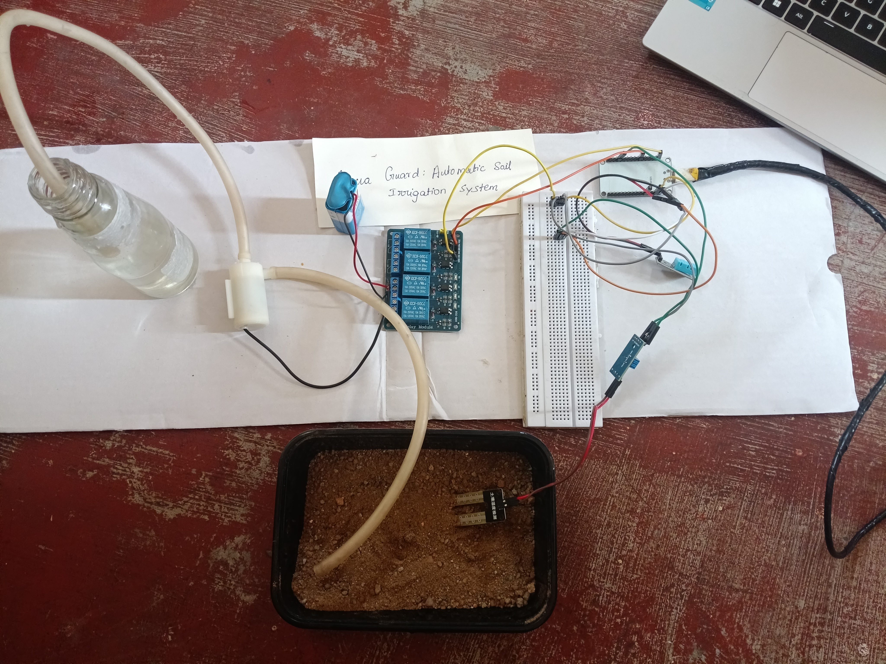

# Aqua Guard: Automatic Soil Irrigation System

An ESP32 based smart irrigation system that waters plants automatically when the soil gets dry.

## How it works
- Soil moisture sensor checks the soil moisture
- If moisture is below 40%, the relay turns ON the water pump
- When the soil is wet again, the pump turns OFF
- DHT11 sensor shows temperature and humidity on the Serial Monitor

## Components
- ESP32 Dev Board
- Soil Moisture Sensor
- DHT11 Temperature and Humidity Sensor
- 4 Channel Relay Module (using IN2)
- DC Water Pump
- 9V Battery
- Breadboard and jumper wires

## Pin Connections
| Component | ESP32 Pin |
|-----------|-----------|
| DHT11 OUT | GPIO4 |
| Soil Sensor AO | GPIO34 |
| Relay IN2 | GPIO27 |

## Code
See `AquaGuard.ino`

## Output

## Future Improvements
- WiFi monitoring using phone or web dashboard
- Water tank level sensor
- Mobile notifications
